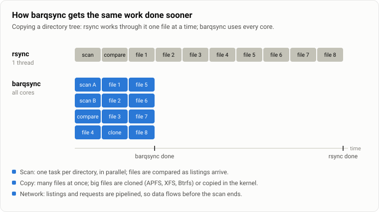
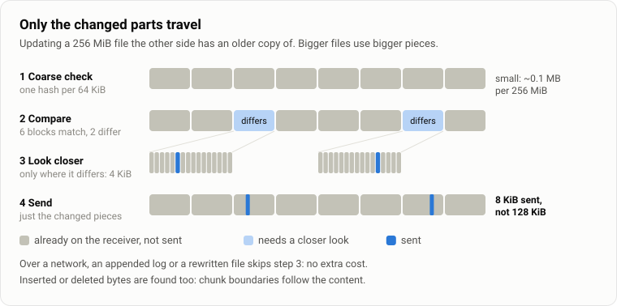

# barqsync

[](https://github.com/Abdurahman-hassan/barqsync/actions/workflows/ci.yml)
[](https://crates.io/crates/barqsync)
[](https://crates.io/crates/barqsync)
[](#license)

**rsync, on every core.** barqsync is a file synchronizer for macOS and Linux that takes
rsync's command line. It scans and copies in parallel, clones big files instead of copying
them, and sends only the parts of a file that changed.


- **Same commands as rsync:** `-avz`, `--delete`, `--exclude`, `-e ssh`, `--link-dest` and
  most other everyday flags.
- **2–5× faster on big trees:** directories are scanned and files copied in parallel.
- **Small updates stay small:** a changed file is compared in 64 KiB blocks, then in smaller
  pieces where it differs (4 KiB when the old copy is up to 256 MiB, larger for larger ones). A SQLite database
  after 8,000 changes sends 30 MB; rsync sends 104 MB.
- **Made for real networks:** ssh by default, parallel TLS streams or QUIC for long or lossy
  links, or `--transport auto` to use QUIC only where the round trip is long, UDP gets
  through and the link isn't known to be clean.

## Install

Prebuilt binaries for macOS (arm64, x86_64) and Linux (x86_64, aarch64; glibc) are attached
to each [GitHub release](https://github.com/Abdurahman-hassan/barqsync/releases) as
`.tar.gz` archives with SHA-256 checksums. To install one:

```bash
cargo binstall barqsync     # with https://github.com/cargo-bins/cargo-binstall
curl --proto '=https' --tlsv1.2 -LsSf https://github.com/Abdurahman-hassan/barqsync/releases/latest/download/barqsync-installer.sh | sh
```

Or build it from source:

```bash
cargo install barqsync
```

This needs Rust ([rustup.rs](https://rustup.rs)). If your shell can't find `barqsync`
afterwards, add Cargo's bin directory to your `PATH`:

```bash
echo 'export PATH="$HOME/.cargo/bin:$PATH"' >> ~/.zshrc && source ~/.zshrc    # zsh (macOS)
echo 'export PATH="$HOME/.cargo/bin:$PATH"' >> ~/.bashrc && source ~/.bashrc  # bash (Linux)
```

To copy to or from another machine, install barqsync there too, from the same release line
(0.4.x uses protocol 10 and cannot communicate with 0.3.x or earlier releases).

## Quick start

```bash
# Copy a folder's contents
barqsync -av photos/ /Volumes/Backup/photos/

# Mirror it: also delete files that are gone from the source
barqsync -av --delete photos/ /Volumes/Backup/photos/

# Preview first: list what would change, change nothing
barqsync -avn --delete photos/ /Volumes/Backup/photos/

# Push to a server over ssh (compressed), then pull from it
barqsync -avz project/ me@server:/srv/project/
barqsync -av me@server:/var/log/app/ ./logs/

# Leave things out
barqsync -av --exclude='*.tmp' --exclude='node_modules/' src/ dst/

# One progress line for the whole transfer
barqsync -a --info=progress2 big-folder/ /mnt/copy/
```

Like rsync, barqsync creates the destination folder but not missing folders above it:
`/Volumes/Backup` has to exist for the first example.

**Mind the trailing slash**, exactly as in rsync:

```text
barqsync -a photos/ backup/    →  backup/a.jpg  backup/b.jpg           (what is inside photos)
barqsync -a photos  backup/    →  backup/photos/a.jpg  backup/photos/b.jpg   (photos itself)
```

### More examples

| To… | Run |
| --- | --- |
| keep daily snapshots that share unchanged files | `barqsync -a --link-dest=../monday/ docs/ backups/tuesday/` |
| keep a partial file if the connection drops, with progress | `barqsync -aP big.iso me@server:/isos/` |
| compare files by content, not size and time | `barqsync -ac src/ dst/` |
| copy only the files named in a list | `barqsync -a --files-from=list.txt src/ dst/` |
| use another ssh port or key | `barqsync -a -e "ssh -p 2222" src/ me@server:dst/` |
| sync over a lossy or long-distance link | `barqsync -a --transport quic data/ me@server:data/` |
| use QUIC on long links, the ssh pipe on short or clean ones or where UDP is blocked | `barqsync -a --transport auto data/ me@server:data/` |
| fill a fast link with parallel connections (through ssh if a firewall blocks them) | `barqsync -a --streams 8 data/ me@server:data/` |
| compress automatically to suit a slow link | `barqsync -a --strategy adaptive logs/ me@server:logs/` |

## How it works



rsync handles one file at a time at each end. barqsync runs one task per directory on all
cores, compares files as soon as each listing arrives, copies many files at once, and lets the
file system clone big files (APFS, XFS, Btrfs) or copy them inside the kernel. Over a network
the listings, requests and data are pipelined, so the transfer starts before the scan ends.

## Small changes, small transfers



When the other side already has an older copy of a file, barqsync first compares cheap
64 KiB fingerprints, then takes a closer look only where they differ. The piece size follows
the size of the old copy: 4 KiB up to 256 MiB, then 8 KiB up to 1 GiB, 16 KiB up to 4 GiB
and 32 KiB up to 16 GiB, so the closer look's cost stays small; above 16 GiB the 64 KiB
comparison is the final one. Every reused piece is
verified with BLAKE3, so nothing is assumed to match. Over a network, an appended log or a
rewritten file skips the closer look, so it costs no more than a plain comparison.

## Benchmarks


Every result is checked byte for byte against the source. barqsync is faster on 7 of these 8;
40 files with a 1 KiB edit each are 6% slower, where per-file overhead dominates. On a fast
LAN the picture is the same, and transfers that are limited by the link or by ssh's
encryption are a tie. Method, raw data and more cases:
[the implementation notes](docs/implementation.md#benchmarks) and
[the delta engine comparison](docs/fast-rsync-comparison.md).

## Options at a glance

| Area | Options |
| --- | --- |
| **Basics** | `-a` (= `-rlptgoD`), `-r`, `-v`, `-q`, `-n` (dry run), `-z`, `-h`, `--stats`, `--no-OPTION` (`-a --no-o --no-g`) |
| **What to copy** | `--exclude`, `--include`, `--exclude-from`, `--include-from`, `--filter`/`-f`, `-F`, `-C`, `-m`, `--files-from`, `-R`, `-d`, `-x`, `--max-size`, `--min-size`, `--existing`, `--ignore-existing`, `-u` |
| **Deleting** | `--delete`, `--delete-before`/`-during`/`-delay`/`-after`, `--delete-excluded`, `--max-delete`, `--force`, `--ignore-errors`, `--ignore-missing-args`, `--delete-missing-args`, `--remove-source-files` |
| **Comparing** | `-c`, `--size-only`, `-I`, `--modify-window` |
| **Writing** | `--inplace`, `--append`, `--append-verify`, `-T`, `--delay-updates`, `--partial`, `--partial-dir`, `-P`, `-S`, `-W`, `--no-whole-file`, `--fsync`, `--mkpath`, `-b`, `--backup-dir`, `--suffix`, `--link-dest`, `--compare-dest` |
| **Links and metadata** | `-l`, `-L`, `-k`, `-K`, `--safe-links`, `--copy-unsafe-links`, `--munge-links`, `-H`, `-p`, `-E`, `-t`, `-U`, `-N` (macOS), `-g`, `-o`, `-D`, `-O`, `-X` (extended attributes), `-A` (ACLs), `--numeric-ids`, `--chmod`, `--chown`, `--usermap`, `--groupmap` |
| **Remote** | `-e`, `--remote-path`, `--timeout`, `--bwlimit`, `-s`, `--transport` (ssh, tcp, quic, auto), `--streams N`, `--strategy adaptive`, `--compress-level N` |
| **Output** | `-i`, `--out-format`, `--progress`, `--info=progress2` |

Every option, and where barqsync differs from rsync:
[the implementation notes](docs/implementation.md#supported-options).

## Good to know

- **macOS and Linux only.**
- **Upgrade both machines to 0.4.2.** The 0.4.x line fixes security and data-loss bugs
  found in an audit; 0.4.1 adds the complete-scan deletion barrier and 0.4.2 improves
  remote interruption and shutdown. See the [changelog](CHANGELOG.md). Protocol 10
  cannot communicate with 0.3.x or earlier.
- **Remote copies need barqsync on both machines,** like rsync, or `--remote-path` to point
  at it. Both ends must run the same release line.
- **Remote paths:** use `host:path` or `'user@[::1]:path'` for IPv6 (quote brackets in
  your shell). Scoped IPv6 such as `'[fe80::1%en0]:path'` is supported. An empty path
  means the remote home; `~/` and known `~user/` prefixes resolve on the remote host.
  Spaces, quotes and other filename bytes are literal. Prefix local names containing
  a colon with `./`. User names and host aliases accept ASCII letters, digits and
  `._-+`, with no leading `-`; configure other login names in SSH configuration.
- **Not supported yet:** daemon mode (`rsync://`, `host::module`) and a few rarer flags such
  as `--fuzzy`, `--copy-dest` and `--log-file`; see the
  [implementation notes](docs/implementation.md#supported-options) for the list.
- **`-X` and `-A` follow rsync's rules** on each system (which attribute namespaces are
  copied, POSIX ACLs on Linux, extended ACLs on macOS); ACLs aren't translated between the two.

## Learn more

All documentation is in [`docs/`](docs/README.md):

- [Implementation notes](docs/implementation.md): every option, how each part works, and
  what the measurements showed.
- [Delta engine comparison](docs/fast-rsync-comparison.md): how the delta engine was
  measured and improved against fast_rsync and rsync.
- [As-built plan](docs/as-built-plan.md): the architecture, and the original plan next to
  what was built.
- [The October 2026 audit](docs/audit/README.md): the security and data-loss fixes in
  0.4.x, and what remains.
- [What's left](docs/remaining.md).

## License

Licensed under either of [MIT](LICENSE-MIT) or [Apache-2.0](LICENSE-APACHE), at your option.
